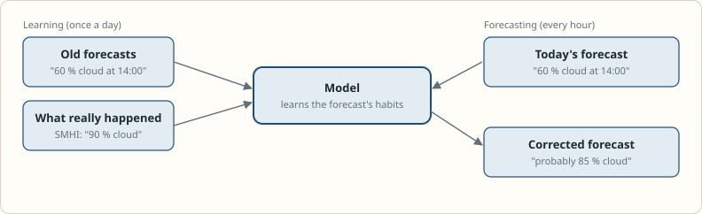

# 🌤️ Skysightsign

**Live page:** https://skysightsign.vercel.app · **Presentation with diagrams:** [presentation/index.html](presentation/index.html)

## Learning from old forecasts

It learns from old *forecasts* rather than from old weather on purpose: that way it sees exactly the kind of input it gets in real life, mistakes included. A second weather model (DWD's ICON) and the time of day and year also go in.

## The overcast devil

A second, simpler model sits on top: the **devil**. It answers only one question: *will the sky be completely grey?* To decide, it also asks five other weather models (from Denmark, the US, the UK, France and ECMWF) what they think. If enough signs point to grey, the devil overrules the main model and says 100 %. Otherwise the main model's number stands.

## Rain, snow or sleet

A separate model, trained on what SMHI's station reported (rain, snow, sleet or nothing), decides the precipitation type. A day is only labelled rainy if a good share of its hours are wet, so one short shower doesn't spoil a sunny day.

## Credits

Weather icons: Yr/NRK, CC BY 4.0. Forecast data: Open-Meteo. Observations: SMHI. Map: © OpenStreetMap contributors.

